# Agents and A2UI: Generative UI with ADK, A2A, MCP and Flutter

Slides and the full working demo for the talk **Powering Generative UI in the Cloud** by Joshua M. de Guzman, Google Developer Expert for Flutter and Dart.

An AI agent sends a description of the screen as A2UI v0.9 JSON. The Flutter app renders it with its own widgets from an approved catalog. No generated code runs on the device.

- **Slides:** [joshuamdeguzman.com/agents-a2ui-cdo](https://joshuamdeguzman.com/agents-a2ui-cdo/) (or open `index.html` locally)
- **Demo:** [`projects/siargao-genui`](projects/siargao-genui), a Siargao travel planner

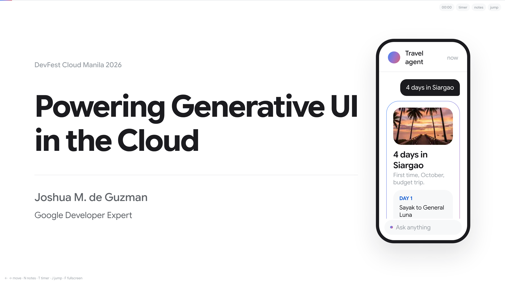

## What's in this repo

| Path | What it is |
| --- | --- |
| `index.html` | The slide deck, one self-contained HTML file. Arrow keys to move, `N` for notes, `J` to jump |
| `projects/siargao-genui/app` | Flutter app (web, iOS, Android) built on the GenUI SDK |
| `projects/siargao-genui/agent` | Python ADK agent that returns A2UI over A2A, deployable to Cloud Run |
| `projects/siargao-genui/mcp` | MCP server with one static surface (resource) and one templated surface (tool) |
| `projects/siargao-genui/catalog` | The widget catalog: names and JSON schemas shared by app and agent |
| `projects/siargao-genui/fixtures` | Recorded A2UI for every demo prompt, used in offline mode |
| `projects/siargao-genui/docs` | Contract, architecture, runbook and screenshots |

## The talk

| | |
| --- | --- |
| 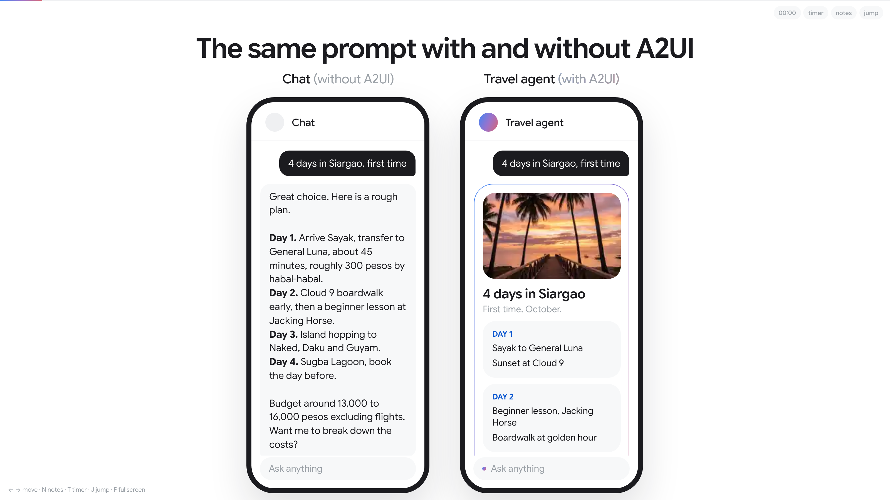 | 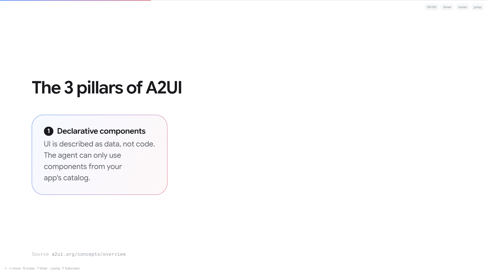 |
| 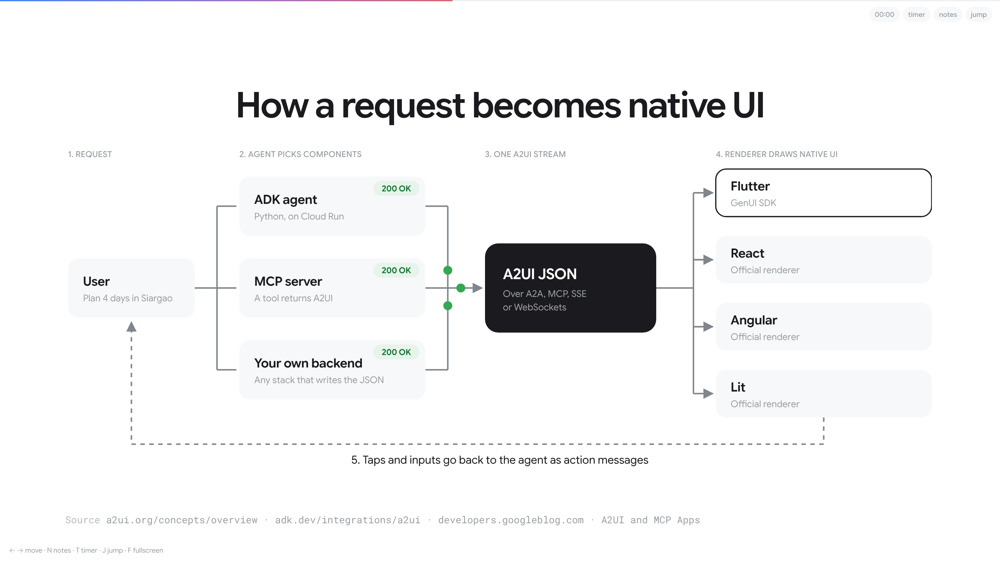 | 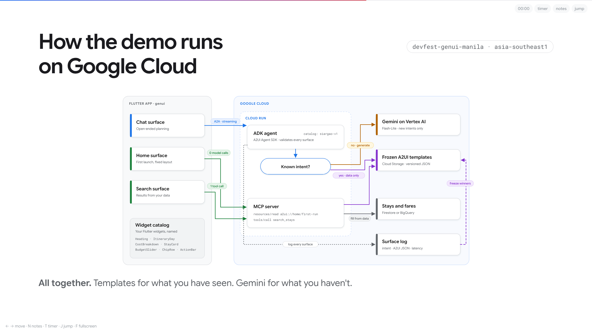 |
| 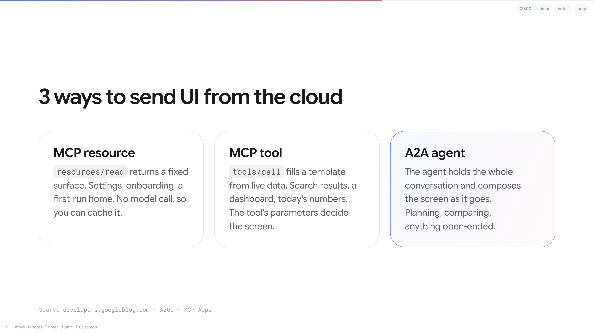 | 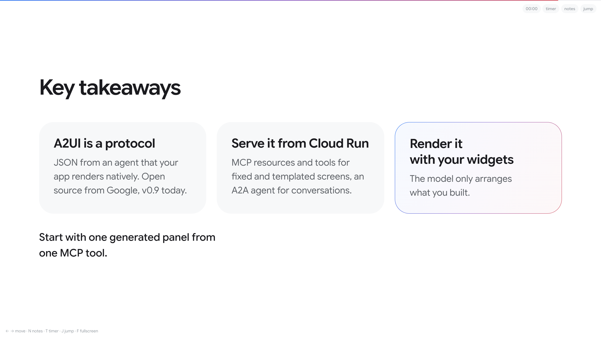 |

## The demo

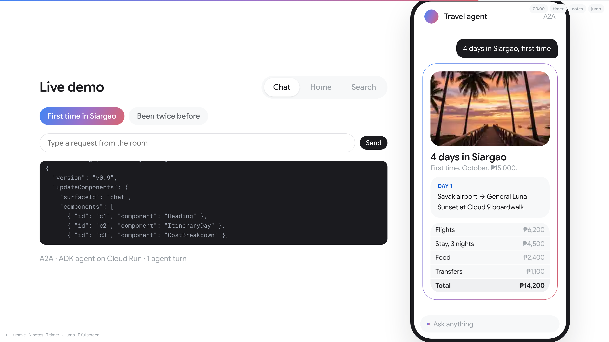

The same Flutter app gets UI three ways:

- **Chat:** an ADK agent on Cloud Run streams A2UI over A2A. Known prompts use saved templates, new prompts go to Gemini.
- **Home:** an MCP resource returns a fixed A2UI surface.
- **Search:** an MCP tool fills a templated A2UI surface with results.

| Chat | Home | Search |
| --- | --- | --- |
| 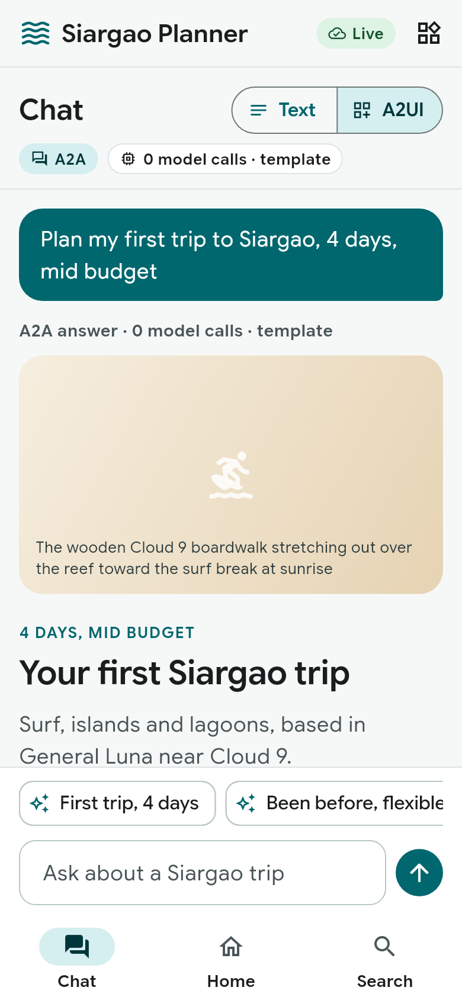 | 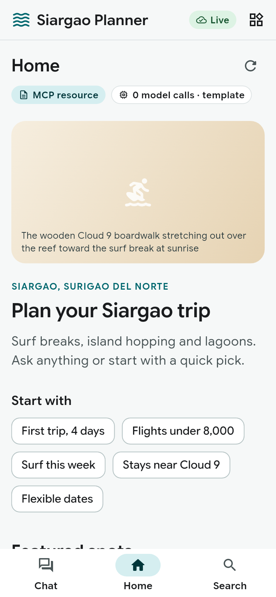 | 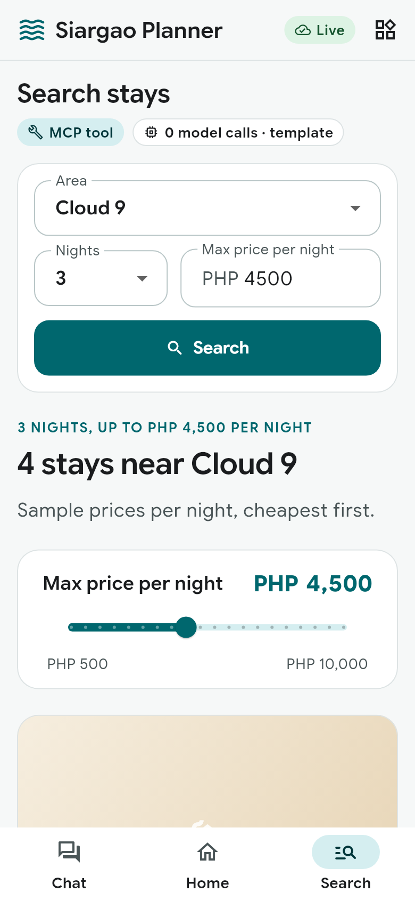 |

## Run it

You need Flutter, Python 3.11+ and, for the cloud mode, the gcloud CLI.

```sh
cd projects/siargao-genui
./run.sh --offline  # app only, recorded fixtures, no keys needed
./run.sh --local    # agent and MCP server on your machine
./run.sh            # app against Cloud Run (asks before deploying)
./run.sh --help     # all options
```

`run.sh` asks only for settings it has not saved yet (Google Cloud project, Gemini API key or Vertex AI) and keeps them in `.env.local`, which git ignores. Nothing is deployed until you type `deploy`.

Run the tests:

```sh
cd projects/siargao-genui/agent && pip install -r requirements.txt -r requirements-dev.txt && pytest
cd ../mcp && pip install -r requirements.txt -r requirements-dev.txt && pytest
cd ../catalog && pip install -r requirements.txt pytest && pytest
cd ../app && flutter test
```

Start with [`docs/RUNBOOK.md`](projects/siargao-genui/docs/RUNBOOK.md). The shared rules live in [`docs/CONTRACT.md`](projects/siargao-genui/docs/CONTRACT.md) and the design in [`docs/ARCHITECTURE.md`](projects/siargao-genui/docs/ARCHITECTURE.md).

## Links

- [A2UI](https://github.com/a2ui-project/a2ui)
- [Flutter GenUI SDK](https://github.com/flutter/genui)
- [Agent Development Kit](https://google.github.io/adk-docs/)
- [Agents CLI](https://google.github.io/agents-cli/)

## License

[MIT](LICENSE). Fonts in `projects/siargao-genui/app/assets/fonts` keep their own license (see `OFL.txt`).
